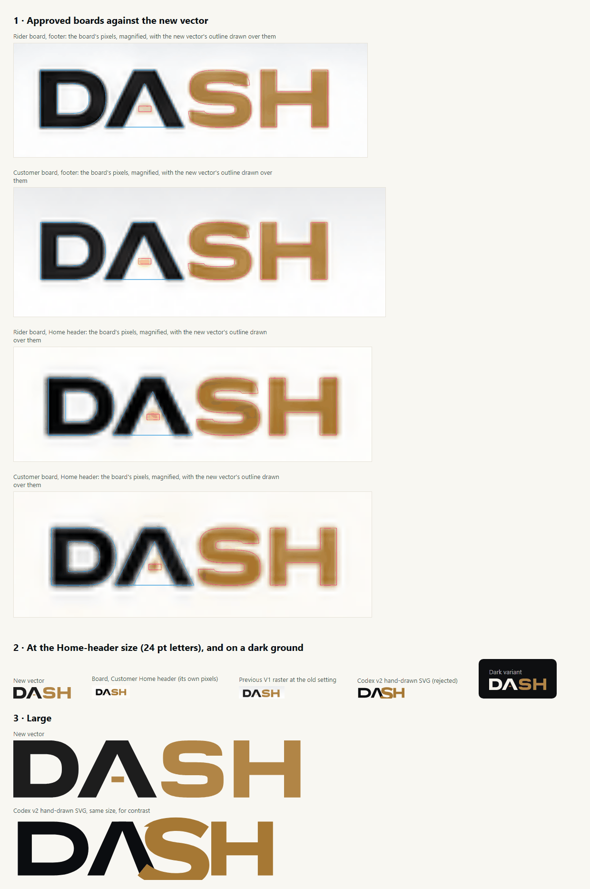
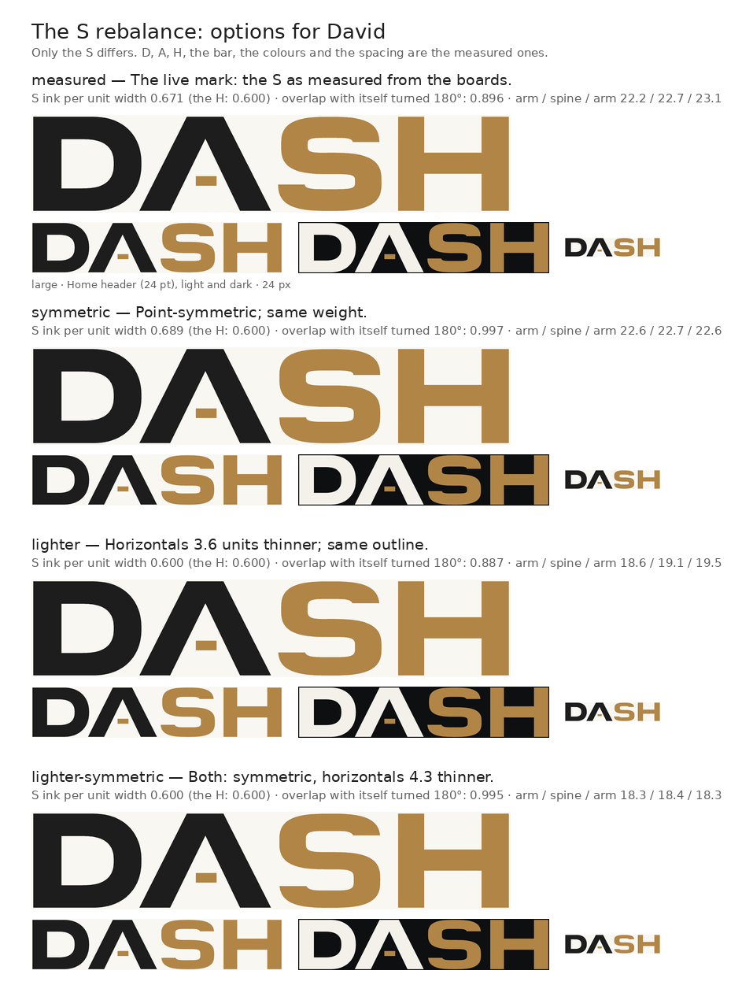

# The DASH wordmark: measured from the approved boards

**Locked brand requirement (David, 14 September 2026).** Wherever the DASH brand
appears, it is this artwork: exactly `DASH`, all capitals, no dot after it,
with the letter shapes, proportions and graphite and bronze of the approved
boards. It is never typed, never set in Manrope or any other font, and never
approximated with weight or letter-spacing. In the app it is rendered only by
`apps/mobile/src/brand/Wordmark.tsx`.



## Why it had to be derived

There is no master file for the mark. The only approved source is the 13
September boards, which are AI-rendered mock-ups where the wordmark is small:

| Appearance | Cap height on the board |
|---|---|
| Rider board footer | 26.7 px |
| Customer board footer | 23.0 px |
| Rider board, Home header | 15.0 px |
| Customer board, Home header | 12.8 px |
| Vendor board footer (reference only, not used) | 25.0 px |

Two earlier answers were wrong:

- **Checkpoint 1 raster crop** (`assets/brand/dash-wordmark.png`, now deleted).
  It had the right shapes but was soft. It also carried wide transparent
  padding, so at `height={26}` the letters were only about 12.5 pt tall, half the
  boards' size, and looked cropped and small in the header.
- **Codex v2 hand-drawn SVG** (`src/v2/brand/Wordmark.tsx` on
  `codex/native-mobile-v2-rebuild`). It was crisp but drawn by eye, and did not
  have the boards' letterforms. It was rejected.

Tracing pixels this small with a generic tracer gives wobbly outlines, and
drawing by eye is what the brand rule forbids. So the letters were **measured**.

## Method

`derive_wordmark.py` does the following:

1. **Separates the inks.** For each appearance, it finds how much graphite
   and how much bronze covers each pixel, by solving
   `background·(1−a−b) + graphite·a + bronze·b` per pixel.
2. **Models each letter as geometry:**
   - **D:** square on the left, superellipse bowl on the right, with its counter.
   - **A:** open, with no crossbar and a flat top. Its counter is a notch from
     the baseline, and the short bronze bar floats in that counter.
   - **S:** two stacked superellipse rings that share the spine. They are
     solved so that both edges of the spine meet exactly, and each ring is cut
     horizontally at its terminal, which leaves the short hooks the boards show.
   - **H:** straight stems and a crossbar.
3. **Solves the geometry against the board.** The model is rendered and
   anti-aliased at the board's own scale. Its parameters, and a blur, are
   adjusted until the render reproduces the board's coverage.
4. **Averages the four Customer and Rider appearances** in cap-height units,
   weighted by size. The Vendor board is measured only as a cross-check.
5. **Emits the outlines.** Curves are sampled and simplified to within 0.01
   units (1/10,000 of the cap height), which is exact at any size a phone will
   draw.

## Results

**How well one mark explains every board.** Each figure is the RMS coverage
error per pixel, where 0 means a perfect match.

| Appearance | Free fit of that appearance alone | The single averaged mark |
|---|---|---|
| Rider footer | 0.045 | 0.051 |
| Customer footer | 0.040 | 0.041 |
| Rider Home header | 0.034 | 0.047 |
| Customer Home header | 0.028 | 0.041 |
| Vendor footer (not averaged) | 0.043 | 0.070, because that board is drawn about 3% wider |

The boards agree with each other closely. All figures are in cap-height units,
where the cap height is 100, and ± is the spread between the four boards:

- **D stem:** 29.9 ± 1.0.
- **D top and bottom bars:** 23.9 ± 0.8.
- **S vertical stroke:** 28.0 ± 0.4.
- **S horizontal strokes:** 22.2 to 23.1.
- **H crossbar:** 38.1 to 60.5.
- **Whole mark:** 503.5 × 100, an aspect of 5.03 : 1.

**Colours.** These are the median colours of pixels well inside the letters:
graphite `#1D1D1D`, bronze `#B18546`. The bronze is lighter and warmer than the
button accent `#A67834`. In the app they are the tokens `wordmark.lead` and
`wordmark.bronze`.

**Dark variant.** The boards show the mark only on light grounds. On dark
grounds the graphite letters take the dark scheme's `#F4F1EA` and the bronze is
unchanged, so the mark changes colour, not shape. This variant is derived and
still needs approval.

**Size in the Home headers.** The letters are 24 pt tall. On the boards they
are 12.9 px on a 234 px Customer phone and 15.0 px on a 250 px Rider phone,
which works out to 22.7 pt and 24.7 pt on a 411 pt-wide phone such as the A55.

## What is least certain

- **The bronze bar in the A's counter.** It appears in four of the five
  appearances. The Vendor footer omits it, and that board is reference only.
  It is the smallest feature on the boards (2–6 px), so its size varies most
  between boards: its left and right edges are 172.1 ± 1.7 and 194.1 ± 3.7,
  and its top and bottom 63.2 ± 3.5 and 73.3 ± 2.1. **David should confirm that
  it is intended.**
- **The small hooks at the S terminals.** They are consistent across the
  boards, but at 1–2 px they are close to the limit of what the boards can
  show.
- **Everything else** is measured from AI renders that differ from each other
  by a percent or two. The averaged mark sits within that spread.

**A master SVG from David supersedes all of this.** When it arrives, it
replaces `apps/mobile/src/brand/wordmarkGeometry.ts` and the two SVGs in
`apps/mobile/assets/brand/`, and nothing else changes.

## The S rebalance (28 September): options, not yet applied

David asked for the S to be rebalanced. There is no written description of the
change and no corrected master, so nothing about the live S has been changed.
What was done instead:

**The boards do not ask for a different S.** The S was re-measured with one
more freedom — terminal cuts that may slant, as a residual map of the S
suggested — starting from the fit above. No board's error moved by more than
0.0002 and the fitted slopes came out at about zero. The horizontal cuts, and
the S as a whole, are what the boards show. So a rebalance is a design
decision, not a measuring error, and it needs David's choice.

**The measured S has two imbalances**, measured against the rest of the mark:

| | Measured S | The H beside it |
|---|---|---|
| Ink per unit of width (its "colour") | 0.671 | 0.600 — the S is about 12% heavier |
| Arm / spine / arm | 22.2 / 22.7 / 23.1, counters about 16 | crossbar 22.4 |
| Overlap with itself turned 180° | 0.896 (upper bowl 5.4 narrower, unequal arms and hooks) | — |

`s_rebalance.py` corrects one, both or neither, each as a defined operation on
the measured parameters rather than a drawing. Only the S changes; D, A, H, the
bar, the colours and the spacing stay as measured:

| Option | What it does | S ink per width | Symmetry |
|---|---|---|---|
| `measured` | the live mark | 0.671 | 0.896 |
| `symmetric` | point-symmetric: bowls at their mean width, equal arms and hooks, spine centred | 0.689 | 0.997 |
| `lighter` | the three horizontals thinned equally (3.6 units), spine kept centred, until the S matches the H's colour; outline unchanged | 0.600 | 0.887 |
| `lighter-symmetric` | both (horizontals 4.3 thinner) | 0.600 | 0.995 |



**To apply David's choice** (it rewrites the native and web geometry and the
two SVG masters, and records the option in the generated file's header):

```bash
python s_rebalance.py apply lighter-symmetric   # or symmetric, lighter; `measured` puts it back
```

Then regenerate the launcher icon, splash and store images from the new
geometry (`node apps/mobile/scripts/brand-assets.mjs`, see
`apps/mobile/README.md`). A master SVG from David still supersedes all of this.

## Re-running

```bash
python derive_wordmark.py fit    # about 5 minutes; writes measurements.json
python derive_wordmark.py emit   # writes wordmarkGeometry.ts and the SVG masters
python s_rebalance.py sheet      # redraws s-rebalance-options.png from them
```

This needs Python 3 and Pillow. The fit is deterministic, with fixed seeds.
